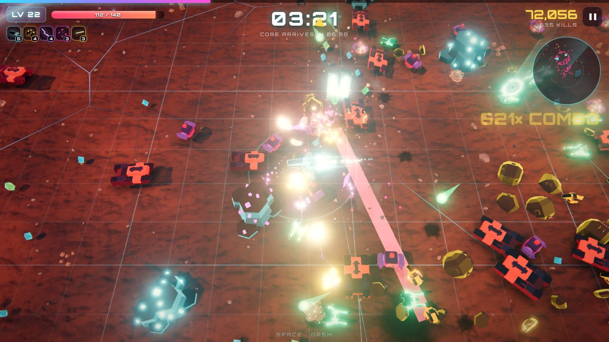
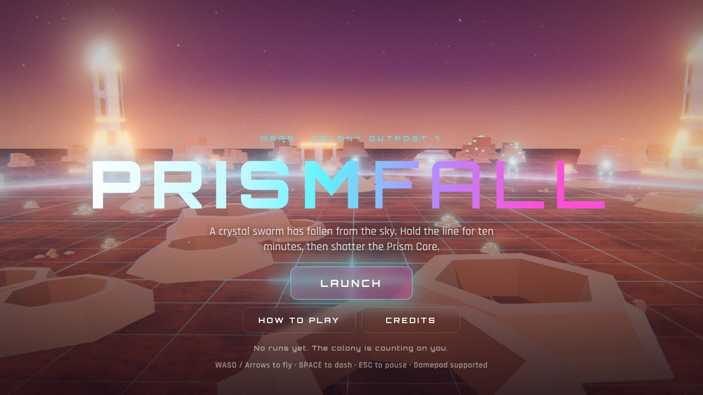
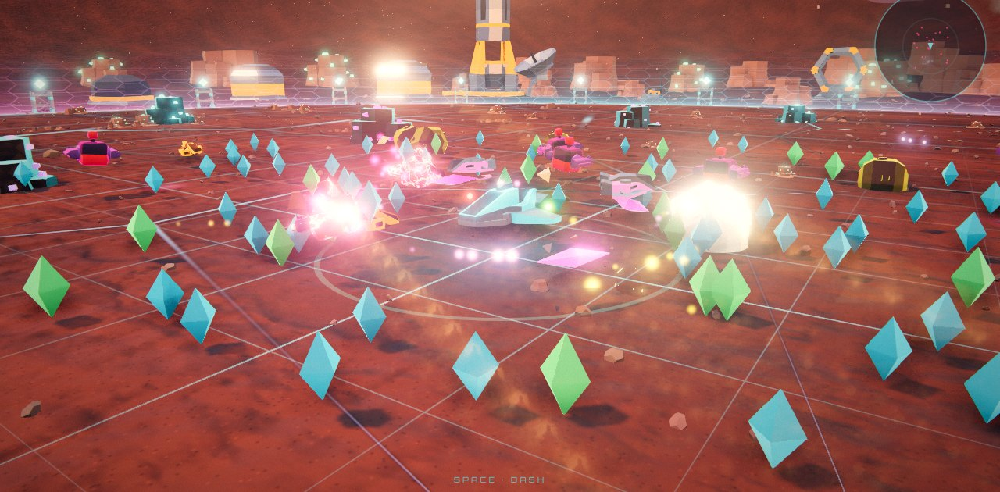
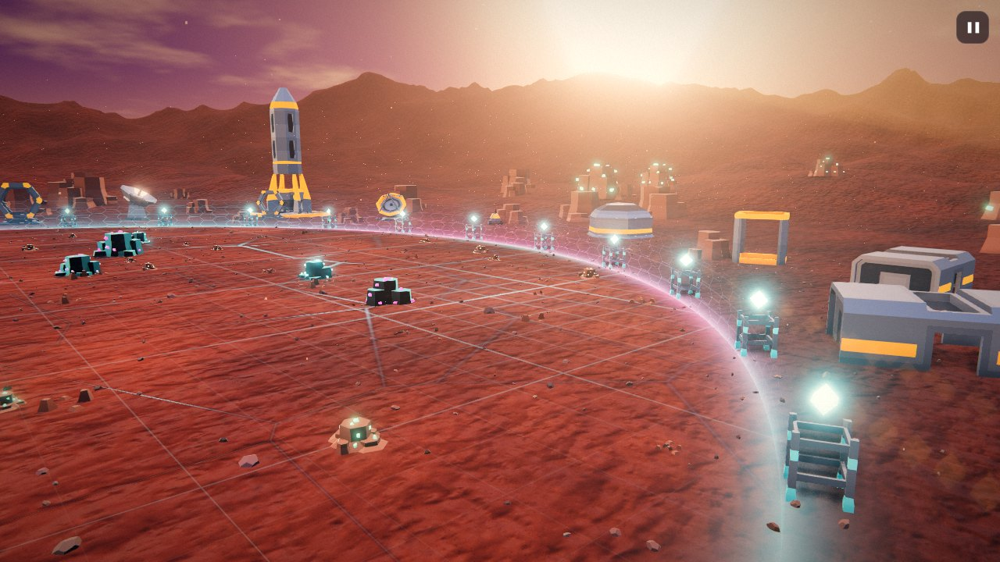
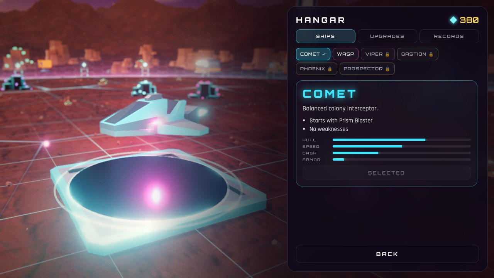
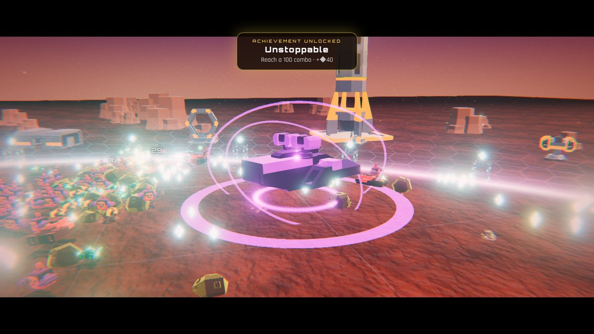
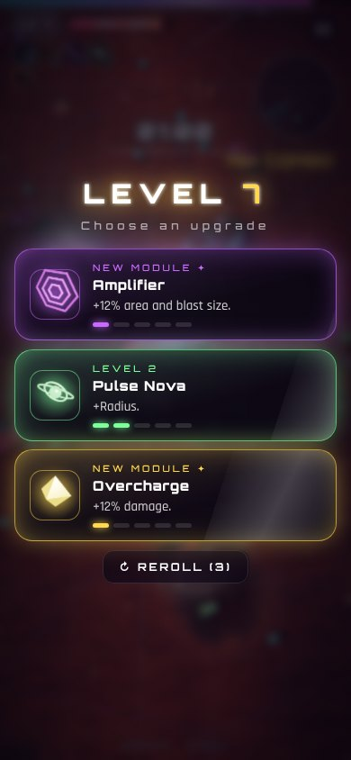

# PRISMFALL

A 3D neon survival shooter set on a Mars colony. A crystal swarm has fallen from the sky. Hold the line for ten minutes, evolve your arsenal, and shatter the Prism Core.









**Play:** https://youssefshaaban07.github.io/prismfall/ (works in any modern browser on PC and phone; installable as an offline app)

## Features

- **Real-time 3D** with Three.js: PBR materials, HDR environment lighting, shadows, GTAO ambient occlusion, bloom, SMAA, depth of field, screen-space shockwave distortion, god rays and a cinematic colour grade
- **Combat VFX**: dissolve deaths, fireballs, lit smoke, glowing-hot shrapnel, ribbon engine trails, ground light pools and pooled explosion lights
- **Mars colony arena**: displaced terrain with dunes, mesas and a mountain range, energy force-field with impact ripples, colony buildings, rockets, prism crystals, clouds, lens flare, twin moons and dust/ion storms
- **9 enemy types**, each with its own behavior: dashing lancers, gunships, splitting meteors, blinking phantoms, sentry pods and seeker mines, plus golden elites
- **6 weapons with evolutions**: Prism Blaster, Halo Blades, Chain Arc, Seeker Swarm, Pulse Nova and Ion Lance. Max a weapon and pair it with the right module to evolve it
- **8 passive modules** and level-up cards with rerolls
- **4 boss fights**, each with a signature attack (carpet bombing, acid rain, laser sweeps), ending with the Prism Core at 10:00. Then endless mode
- **Hangar meta-progression**: earn Prism Shards, unlock 6 ships with different stats and starting weapons, buy permanent upgrades, earn 12 achievements
- **Adaptive soundtrack**: procedural synthwave that builds with the action, layered with sound effects
- **Plays everywhere**: keyboard, gamepad, or touch (floating joystick + dash button); auto graphics quality

| Hangar | Boss fight | Phone |
|---|---|---|
|  |  |  |

## Controls

| Action | Keyboard | Gamepad | Touch |
|---|---|---|---|
| Move | WASD / Arrows | Left stick / D-pad | Drag anywhere |
| Dash | Space / Shift | A / RB | DASH button |
| Pick upgrade | 1 / 2 / 3, R to reroll | X / Y / B, LB to reroll | Tap card |
| Pause | Esc / P | Start | ❚❚ button |
| Mute | M | | |
| Photo mode | F2 (drag / arrows to orbit, wheel to zoom) | | Pause → Photo Mode |

## Run locally

```bash
npm install
npm run dev      # dev server at http://localhost:5173
npm run build    # production build in dist/
npm run preview  # serve the build
```

## Tech

TypeScript, Three.js, Vite, Web Audio API, PWA (Workbox). About 5,000 lines of game code, no game engine.

```
src/
  core/   renderer + post-processing, asset baking, input, audio
  game/   game loop, player, enemies, bosses, weapons, projectiles, hazards, pickups, upgrades, meta progression
  ui/     HUD, menus, hangar, level-up cards
```

Enemies, projectiles and crystals are drawn with GPU instancing, so hundreds of enemies cost only a few draw calls. Static scenery is merged into one mesh per material at load time.

## Credits

All 3D models, sounds and HDRIs are open source (Kenney CC0/MIT, Poly Haven CC0). See [CREDITS.md](CREDITS.md).
